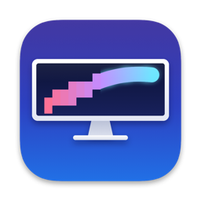

<p align="center">
  
</p>

<h1 align="center">SmoothDisplay</h1>

<p align="center">
  <strong>Retina-smooth text on a regular external monitor, plus MacBook brightness keys and honest colors.</strong><br>
  A free, open-source menu bar app for macOS.
</p>

<p align="center">
  <a href="https://github.com/developerscompany/SmoothDisplay/releases/latest"><strong>Download</strong></a>
  &nbsp;·&nbsp;
  <a href="#install">Install</a>
  &nbsp;·&nbsp;
  <a href="#usage">Usage</a>
  &nbsp;·&nbsp;
  <a href="#troubleshooting">Troubleshooting</a>
  &nbsp;·&nbsp;
  <a href="#українською">Українською</a>
</p>

<p align="center">
  <a href="https://github.com/developerscompany/SmoothDisplay/actions/workflows/build.yml"></a>
  <a href="https://github.com/developerscompany/SmoothDisplay/releases/latest"></a>
  <a href="LICENSE"></a>
</p>

---

## Why

Text on a MacBook screen looks crisp. Connect a typical 27–40" monitor (2560×1440, 3440×1440) and the same text
looks jagged and slightly blurry. It is not your eyes:

- On a monitor that is not "Retina", macOS draws everything at 1x: one point is one pixel.
- macOS has not used subpixel anti-aliasing since Mojave, so letter edges are plain stair steps.
- macOS only smooths well in HiDPI (Retina) modes, and for many monitors it offers no HiDPI mode near the
  panel's own size, only modes that make everything much bigger.

SmoothDisplay switches the monitor into a HiDPI mode that keeps almost the same workspace. On a 3440×1440 panel,
**Retina — native size** is 3424×1433: macOS renders the desktop at 6848×2866 and scales it down to the panel's
3440×1440 pixels. That is supersampling: text and icons come out smooth, close to a MacBook screen, and you give up
only 16 pixels of width.

## Features

- **Retina modes at the size you already use.** Native-size Retina plus presets with 15%, 25%, one third and
  1.5× larger UI, a full list of other sizes, and one click back to standard mode. The highest refresh rate is
  kept (for example 155 Hz).
- **Unlock Retina modes** on monitors macOS does not offer them for: one administrator password, one reconnect.
- **Keeps your mode** when the monitor reconnects or the Mac wakes from sleep.
- **MacBook brightness keys control the external monitor** the pointer is on, with an on-screen indicator and a
  slider in the menu. Hardware backlight over DDC/CI when the monitor supports it, software dimming when it does not.
- **Colors that match your MacBook.** Display profiles built from the monitor's real primaries, with a D65, 6000K,
  5500K or native white point.
- **Thinner text** toggle, **Launch at Login**, update check and a **command line** interface.
- English, Ukrainian and Russian, switchable in the **Language** menu. No dependencies, no telemetry. Signed with a Developer ID certificate and notarized
  by Apple.

## Requirements

- macOS 13 Ventura or later.
- An external monitor. SmoothDisplay helps most on monitors that are not Retina: 1440p-class 27" screens and
  34–40" ultrawides.
- Apple Silicon for hardware brightness. The app is universal (arm64 and x86_64); on Intel Macs hardware (DDC)
  brightness is not available and the app falls back to software dimming. Intel Macs are untested.
- The Accessibility permission, only for the brightness keys.
- An administrator password once, only if you use **Unlock Retina Modes…**.

Tested on a MacBook with M5 running macOS 27 and an MSI MAG401QR (40", 3440×1440, 155 Hz). Reports from other
monitors are welcome, see [Contributing](#contributing).

## Install

1. Download the `.dmg` from the [latest release](https://github.com/developerscompany/SmoothDisplay/releases/latest).
2. Open it and drag **SmoothDisplay** into **Applications**.
3. Open SmoothDisplay from Applications. A display icon appears in the menu bar; there is no Dock icon and no window,
   and a one-time welcome note says where to find it. The app is signed and notarized, so macOS opens it without the
   "unidentified developer" warning. It may still ask once to confirm opening an app downloaded from the internet.
4. macOS asks to give SmoothDisplay **Accessibility** access. It is needed only for the brightness keys. Click
   **Open System Settings** and turn SmoothDisplay on in **Privacy & Security › Accessibility**. The app notices the
   permission within a few seconds, no restart needed. If you skip it, **Allow Brightness Keys…** in the menu asks again.
5. Click the menu bar icon and choose **Retina — native size**.

Optionally turn on **Launch at Login**.

**Updating.** The app checks GitHub for a new release at most once a day and offers to open the release page.
**Check for Updates…** checks right away. To update, quit SmoothDisplay, download the new DMG and replace the app in
Applications. Your settings are kept.

## Usage

Click the display icon in the menu bar. Each external monitor gets its own section: name, current mode, brightness
slider, Retina modes and the Colors submenu. Global settings are at the bottom.

### Retina modes

| Menu item | Result |
|---|---|
| **Retina — native size** | Nearly the same workspace as the panel, with smooth text. 3424×1433 on a 3440×1440 panel. |
| **Retina — 15% larger**, **25% larger**, **one third larger**, **1.5× larger** | Everything bigger and easier to read, less workspace. |
| **More Retina Sizes** | A selection of other HiDPI sizes with the panel's aspect ratio, from the panel size down to half of it. |
| **Standard Mode, No HiDPI** | Back to the plain 1x mode at the panel's resolution. |

- Each item shows its "looks like" size; the checkmark marks the current mode.
- A preset appears only when macOS offers a HiDPI mode close to that size.
- For every size the app picks the highest refresh rate the monitor offers.
- The line under the monitor name shows the current mode, whether it is Retina, and the refresh rate.

**Unlock Retina Modes…** appears when macOS offers no Retina mode close to the panel's size. It writes a display
override file to

```
/Library/Displays/Contents/Resources/Overrides/DisplayVendorID-xxxx/DisplayProductID-yyyy
```

that lists HiDPI backing sizes from 2x the panel down to 1x in 32 px steps. macOS asks for an administrator password
once, in its standard dialog. Then unplug and reconnect the monitor (or restart the Mac), and the Retina presets
appear. On Apple Silicon the widest HiDPI backing store macOS allowed in testing was 6848 px, which is why a
3440×1440 panel gets 3424×1433 rather than exactly 3440×1440.

**Keep Mode After Reconnect and Sleep** (on by default). macOS often falls back to the blurry 1x mode after a
reconnect. The app re-applies the mode you chose, from the menu or with `--apply`, whenever a display connects and
after wake. Monitors are recognized by vendor, model and serial number, so each one keeps its own mode.

> Retina modes render about four times as many pixels as the 1x mode, which costs some GPU memory and power. If a Mac
> feels sluggish, a "larger" preset renders fewer pixels.

### Brightness

- The MacBook brightness keys control the external monitor **the mouse pointer is on**. Move the pointer to the
  built-in screen and the keys work as usual.
- Each press moves one of 16 steps, like the built-in screen. Hold **Option+Shift** for 64 finer steps.
- An on-screen indicator shows the level and percentage on that monitor.
- Each monitor has a brightness slider in the menu.
- **Brightness Keys Control the Monitor Under the Pointer** turns the key handling off and on.

The brightness method is chosen automatically at launch and after a monitor reconnects:

- **Hardware (DDC/CI).** The app nudges the monitor's brightness by one step over DDC/CI and reads it back. If the
  monitor obeys, the keys and the slider change the backlight itself, like the monitor's own buttons.
- **Software dimming.** If the monitor ignores the command, the app dims the picture by scaling the display's gamma
  table on top of the color profile. This works on any monitor, but it cannot go brighter than the brightness set in
  the monitor's own menu (OSD), and it disappears when the app quits (the level comes back on the next launch). Set the
  OSD brightness to the highest level you ever want and dim from there.

When software dimming is in use, the menu says so and offers **Check Monitor Again**. See
[Monitors that ignore brightness commands](#monitors-that-ignore-brightness-commands).

Intercepting the keys needs the Accessibility permission (**System Settings › Privacy & Security › Accessibility**).
The slider works without it.

### Colors

The **Colors** submenu shows the profile in use and offers:

| Menu item | What it does |
|---|---|
| **Like a MacBook without True Tone (D65, 6500K)** | Recommended. Real primaries, white balanced to D65, the white of a MacBook with True Tone off. |
| **Warmer, closer to True Tone (6000K)** | Same, with a warmer white. |
| **Even Warmer (5500K)** | Warmer still. |
| **Monitor's Native White, No Correction** | Real primaries, white exactly as the panel produces it. |
| **macOS Factory Profile (from monitor data)** | The profile macOS created from the monitor's EDID. The default. |

The first four are ICC v2 matrix/TRC display profiles built from the monitor's real primaries, which the app takes
from the EDID-based factory profile macOS creates. The D65, 6000K and 5500K profiles also carry a `vcgt` tag that
shifts the white point in the display pipeline. Profiles are saved in `~/Library/ColorSync/Profiles/SmoothDisplay/`
and assigned through ColorSync, so they stay in effect after the app quits and show up in
**System Settings › Displays › Color profile**.

### Other settings

- **Thinner Text (applies after apps restart)** turns off macOS stem darkening (`AppleFontSmoothing = 0`, current
  host). Strokes get lighter, which many people prefer in Retina modes. Apps pick it up after they restart.
- **Launch at Login** registers SmoothDisplay as a login item. It shows up in
  **System Settings › General › Login Items**.
- **Check for Updates…** and **Check for Updates Automatically**.
- **About SmoothDisplay** shows the version and a link to this repository.
- **Display Settings…** opens **System Settings › Displays**.

## Getting colors to match your MacBook

A common cause of "wrong" colors is a generic profile such as **Adobe RGB** or **sRGB** assigned to a wide-gamut
monitor in its native mode. That profile describes a different display, so macOS converts colors for primaries the
panel does not have, and the picture comes out oversaturated or washed out. That was the problem SmoothDisplay was
first written for. The fix is a profile that describes the panel you actually have.

1. **Set up the monitor's menu (OSD) for an honest picture:**
   - picture mode: the native-gamut **User** mode (on the MSI MAG401QR: Pro Mode = User, Game Mode = User);
   - color temperature: **Normal**;
   - off: dynamic contrast, HDR, night vision, low blue light and image enhancement features
     (on the MSI: HDCR, Night Vision, Low Blue Light, Image Enhancement);
   - sharpness: the default.
2. **Turn HDR off** for the monitor in **System Settings › Displays**.
3. In SmoothDisplay choose **Colors › Like a MacBook without True Tone (D65, 6500K)**.
4. **Compare fairly.** True Tone only adapts external displays up to 32 inches, so on a bigger monitor the MacBook
   screen drifts warmer while the monitor stays put. Turn True Tone (and Night Shift) off on the MacBook while
   comparing. If you prefer to keep True Tone on, pick **Warmer, closer to True Tone (6000K)** or
   **Even Warmer (5500K)** instead.
5. **For an exact match, use a colorimeter.** EDID primaries are the manufacturer's values for the model, not a
   measurement of your unit. Profile the monitor with DisplayCAL 3.9.19 + ArgyllCMS 3.5.0, profile type
   **Single curve + matrix**, ICC v2.

An **sRGB** mode in the monitor's menu only pairs with an sRGB profile, and it clips P3 colors. For the full gamut
use the native mode with a SmoothDisplay profile.

## Monitors that ignore brightness commands

Some monitors support DDC/CI but ignore brightness commands while an OSD feature locks brightness. The MSI MAG401QR,
for example, locks brightness while **MPRT** (backlight strobing) or **HDCR** (dynamic contrast) is on, and while it
receives an **HDR** signal. In that state SmoothDisplay's probe sees no change and falls back to software dimming.

1. In the monitor's menu, turn off features that lock brightness: MPRT or other backlight strobing, dynamic
   contrast, Eco or automatic brightness, HDR. The **Brightness** item in the OSD should no longer be greyed out.
2. If the OSD has a **DDC/CI** option, make sure it is on.
3. Connect the monitor directly if you can. Some docks, KVM switches and DisplayLink adapters do not pass DDC/CI.
4. Choose **Check Monitor Again** in the SmoothDisplay menu. It tells you whether the monitor now accepts
   brightness commands.

The probe result is written to the [log](#troubleshooting), in lines like
`probe MSI MAG401QR: DDC 50/100, wrote 51, read 50 -> software`.

## Command line

The executable inside the bundle doubles as a command line tool:

```bash
alias smoothdisplay=/Applications/SmoothDisplay.app/Contents/MacOS/SmoothDisplay

smoothdisplay --list               # monitors, current mode, presets, remembered mode
smoothdisplay --apply 3424x1433    # switch to a Retina mode from --list (remembered like a menu choice)
smoothdisplay --native             # back to the plain 1x mode
smoothdisplay --brightness         # which brightness method works, and what the monitor reports
smoothdisplay --brightness 40      # set the backlight to 40% over DDC/CI
smoothdisplay --color d65          # d65 | 6000k | 5500k | native | factory
smoothdisplay --color              # current profile, panel primaries from EDID, gamma table peaks
smoothdisplay --login on           # on | off
```

| Option | Description |
|---|---|
| `--list` | Lists external monitors with the current mode, panel size, presets and the remembered mode. |
| `--apply WxH` | Switches to that Retina size. Use a plain `x`, for example `3424x1433`. |
| `--native` | Switches to the standard 1x mode. |
| `--brightness [0-100]` | Probes DDC/CI and prints the method. With a value, sets the backlight (hardware method only; software dimming lives in the running app). |
| `--color [d65\|6000k\|5500k\|native\|factory]` | Generates and assigns a profile, or returns to the factory one. Without a value, prints the color state. |
| `--login on\|off` | Turns Launch at Login on or off. |

`--list` shows every external monitor; `--apply`, `--native`, `--brightness` and `--color` act on the first one.
All commands exit with status 0 on success and 1 on failure.

## Troubleshooting

**Log.** SmoothDisplay writes a short troubleshooting log to `~/Library/Logs/SmoothDisplay.log`: brightness probes,
DDC writes and brightness key events. Open it with `open ~/Library/Logs/SmoothDisplay.log`. It is kept under about
500 KB.

**The brightness keys do nothing on the monitor, or change the MacBook screen instead.**
The pointer must be on the external monitor. Check that SmoothDisplay is allowed in
**System Settings › Privacy & Security › Accessibility**. After an update or a reinstall macOS can keep a stale entry
that looks enabled but no longer matches the app: select SmoothDisplay in that list, remove it with **–**, open the
app again and allow it when asked. The slider and the keys also wait a second or two after launch while the monitor
is checked.

**There are no Retina presets, or only very large sizes.**
Use **Unlock Retina Modes…**, then unplug and reconnect the monitor or restart the Mac. Until then the menu shows
"Retina unlocked — reconnect the monitor cable". If the presets still do not appear, open an issue with the output
of `--list`.

**The mode falls back to the blurry one after sleep.**
Make sure **Keep Mode After Reconnect and Sleep** is on and that you picked the mode in SmoothDisplay or with
`--apply`.

**Colors look wrong.**
Check that no generic profile is assigned in **System Settings › Displays**, choose
**Colors › Like a MacBook without True Tone (D65, 6500K)** and go through the OSD settings in
[Getting colors to match your MacBook](#getting-colors-to-match-your-macbook).

**Reset everything to the macOS defaults.**
Choose **Standard Mode, No HiDPI** and **Colors › macOS Factory Profile (from monitor data)**, turn off
**Thinner Text**, then quit SmoothDisplay (quitting removes software dimming).

**Undo Unlock Retina Modes.**
Delete the override file for your monitor and reconnect it. The vendor and product IDs are in hexadecimal:

```bash
ls /Library/Displays/Contents/Resources/Overrides/
sudo rm /Library/Displays/Contents/Resources/Overrides/DisplayVendorID-xxxx/DisplayProductID-yyyy
```

### Uninstall

1. Reset to the macOS defaults as described above, turn off **Launch at Login** and quit the app.
2. Move `/Applications/SmoothDisplay.app` to the Trash and remove it from the Accessibility list.
3. Optionally remove the generated profiles, log and settings:

   ```bash
   rm -rf ~/Library/ColorSync/Profiles/SmoothDisplay
   rm -f ~/Library/Logs/SmoothDisplay.log
   defaults delete agency.rivo.SmoothDisplay
   ```

4. If you used **Unlock Retina Modes…**, delete the override file as shown above.

## How it works

- **Display modes.** `CGDisplayCopyAllDisplayModes` with `kCGDisplayShowDuplicateLowResolutionModes` returns the
  HiDPI modes macOS hides by default. The app keeps modes usable for the desktop with the panel's aspect ratio,
  between half and full panel width, and the fastest refresh rate for each size. A mode is applied with
  `CGBeginDisplayConfiguration` / `CGConfigureDisplayWithDisplayMode` / `CGCompleteDisplayConfiguration`
  (`.permanently`) and re-applied from a `CGDisplayRegisterReconfigurationCallback` and on
  `NSWorkspace.didWakeNotification`.
- **Unlocking Retina modes.** A display override plist (`DisplayVendorID`, `DisplayProductID`, `DisplayProductName`,
  `scale-resolutions`) in `/Library/Displays/Contents/Resources/Overrides`. Each `scale-resolutions` entry is a
  backing size, from 2x the panel down to 1x in 32 px steps, and macOS offers a HiDPI mode at half of it. The file is
  written by `osascript` with administrator privileges.
- **Hardware brightness.** DDC/CI over `IOAVService` on Apple Silicon: the private `IOAVServiceCreateWithService`,
  `IOAVServiceReadI2C`, `IOAVServiceWriteI2C` and `IOAVServiceCopyEDID` functions, resolved at runtime with `dlsym`,
  on the external `DCPAVServiceProxy` service whose EDID matches the display. Brightness is VCP code `0x10`. The probe
  reads the value, writes it plus or minus one, reads it back after 300 ms and restores it. Writes are coalesced on a
  background queue, so holding a key never queues up stale values.
- **Software dimming.** The current gamma table (including any `vcgt` from the profile) is read with
  `CGGetDisplayTransferByTable`, scaled by the level (perceptually, `level^(1/2.2)`) and written back with
  `CGSetDisplayTransferByTable`. It is re-applied when ColorSync reloads the tables (profile change, wake) and
  removed with `CGDisplayRestoreColorSyncSettings` when the app quits.
- **Color profiles.** The app reads `rXYZ`, `gXYZ`, `bXYZ`, `wtpt` and `chad` from the EDID-based factory profile and
  undoes the D50 adaptation to get the panel's real primaries and white. For a target white it computes per-channel
  gains so full white lands on that point, then writes an ICC v2 matrix/TRC profile with a Bradford `chad` tag and an
  Apple `vcgt` formula tag that applies the gains in the display pipeline. The profile is assigned with
  `ColorSyncDeviceSetCustomProfiles` for the current user.
- **Brightness keys.** A `CGEvent` tap on the session receives `NX_SYSDEFINED` events (`NX_KEYTYPE_BRIGHTNESS_UP` and
  `_DOWN`) and the brightness key codes, drops duplicates of the same press, and swallows the event only when the
  pointer is on an external monitor. Event taps that can block input need the Accessibility permission.
- **Thinner text** writes `AppleFontSmoothing = 0` to the global current-host preferences, the same as
  `defaults -currentHost write -g AppleFontSmoothing -int 0`. **Launch at Login** uses `SMAppService.mainApp`.

## Privacy

- No telemetry, no analytics, no accounts.
- The only network access is the update check: a request to `api.github.com` for the latest release of this
  repository. GitHub sees your IP address and the app's version in the User-Agent. Turn off
  **Check for Updates Automatically** to stop the daily check.
- Everything else stays on your Mac: settings in the `agency.rivo.SmoothDisplay` preferences, profiles in
  `~/Library/ColorSync/Profiles/SmoothDisplay/`, the log in `~/Library/Logs/SmoothDisplay.log`, and the override
  file in `/Library/Displays` only if you use **Unlock Retina Modes…**.

## Build from source

You need macOS 13 or later and the Xcode Command Line Tools (`xcode-select --install`). There are no dependencies and
no Xcode project.

```bash
git clone https://github.com/developerscompany/SmoothDisplay.git
cd SmoothDisplay
./build.sh            # builds build/SmoothDisplay.app (universal: arm64 + x86_64)
./build.sh --install  # also replaces /Applications/SmoothDisplay.app with it and launches it
```

`build.sh` signs the app with the certificate named in `SIGN_IDENTITY`, otherwise with the first
**Apple Development** certificate in your keychain, otherwise ad-hoc. macOS ties the Accessibility permission to the
code signature, so an ad-hoc build loses it on every rebuild; a free Apple Development certificate
(Xcode › Settings › Accounts) avoids that. A dev build is signed differently from the release, so after switching
between them you may need to re-allow SmoothDisplay in the Accessibility list.

**Releases** (maintainers): `scripts/release.sh` regenerates the localized strings, builds the app with the hardened
runtime, signs it with the **Developer ID Application** certificate, notarizes and staples the app and the DMG with a
`notarytool` keychain profile (`xcrun notarytool store-credentials`), and writes `build/SmoothDisplay-<version>.dmg`.
Run it as `NOTARY_PROFILE=<your profile> scripts/release.sh`; `TEAM_ID` selects a different signing team.

```
Sources/                      Swift sources (AppKit, no dependencies)
Resources/*.lproj/            Localizable.strings for en, uk, ru (generated by scripts/strings.py)
Info.plist                    bundle metadata
build.sh                      development build
scripts/release.sh            signed, notarized DMG
scripts/strings.py            translation tables, regenerates Resources/*.lproj
scripts/make-icon.swift       app icon generator
```

## Contributing

Bug reports, monitor reports and pull requests are welcome. DDC/CI behaviour differs a lot between monitors, so an
issue is most useful with the monitor model, the connection (port, cable, dock), the Mac and macOS version, and the
relevant lines from `~/Library/Logs/SmoothDisplay.log`. See [CONTRIBUTING.md](CONTRIBUTING.md) for building, code
style and localization. Changes are listed in [CHANGELOG.md](CHANGELOG.md).

## License

[MIT](LICENSE). Copyright (c) 2026 Rivo Agency.

SmoothDisplay is not affiliated with Apple or MSI. macOS, MacBook, Retina and True Tone are trademarks of Apple Inc.

---

## Українською

SmoothDisplay — безкоштовна програма з відкритим кодом для рядка меню macOS. Вона вмикає Retina (HiDPI) на звичайному
зовнішньому моніторі, дає керувати його яскравістю клавішами MacBook і ставить чесні кольори.

### Навіщо

На моніторі без Retina macOS малює все в масштабі 1x і без субпіксельного згладжування, тому краї літер виходять
«драбинкою». Гладко macOS малює лише в HiDPI-режимах. У режимі «Retina — звичайний розмір» на панелі 3440×1440
система малює робочий стіл у 6848×2866 і зменшує його до 3440×1440. Текст стає гладким, як на MacBook, а робочого
простору майже стільки ж: 3424×1433.

### Встановлення

1. Завантажте `.dmg` з [останнього релізу](https://github.com/developerscompany/SmoothDisplay/releases/latest).
2. Відкрийте його й перетягніть **SmoothDisplay** у **Програми** (Applications).
3. Запустіть SmoothDisplay. Значок монітора з'явиться в рядку меню, у Dock програми немає. Програма підписана
   сертифікатом Developer ID і нотаризована Apple, тому відкривається без попередження про невідомого розробника.
4. macOS попросить дозвіл на універсальний доступ (Accessibility). Він потрібен лише для клавіш яскравості. Увімкніть
   SmoothDisplay у **Системні параметри › Приватність і безпека › Універсальний доступ** (System Settings › Privacy &
   Security › Accessibility). Перезапуск не потрібен. Якщо пропустили запит, у меню є пункт «Дозволити клавіші
   яскравості…».
5. Натисніть значок у рядку меню й виберіть «Retina — звичайний розмір».

Потрібна macOS 13 Ventura або новіша. Апаратна яскравість працює лише на Apple Silicon; на Mac з Intel програма
затемнює картинку програмно (на Intel її не тестували). Меню українською, англійською або російською: за мовою системи або на вибір у пункті «Мова».

### Що вміє

- **Retina-режими**: «Retina — звичайний розмір», а також усе на 15%, 25%, третину і в 1,5 раза більше. Решта
  розмірів у підменю «Інші Retina-розміри», повернення назад — «Звичайний режим без HiDPI». Частота оновлення
  найвища з доступних (наприклад, 155 Гц).
- **«Розблокувати Retina-режими…»** — для монітора, якому macOS не пропонує Retina близько до розміру панелі. Записує
  файл перевизначення в `/Library/Displays/Contents/Resources/Overrides/` і один раз просить пароль адміністратора.
  Діє після перепідключення кабелю або перезавантаження.
- **«Тримати режим після перепідключення і сну»** повертає обраний режим, коли macOS скидає монітор на розмитий 1x.
- **Яскравість** клавішами MacBook, повзунок у меню, індикатор на екрані.
- **Кольори**: профілі з реальних основних кольорів матриці.
- **«Тонший шрифт (діє після перезапуску програм)»** вимикає системне потовщення літер (`AppleFontSmoothing = 0`).
- **«Запускати при вході в систему»**, «Перевірити оновлення…» (автоматично не частіше разу на добу, вимикається
  пунктом «Перевіряти оновлення автоматично»), командний рядок.

### Яскравість

- Клавіші яскравості MacBook керують монітором, над яким курсор. Над вбудованим екраном вони працюють як завжди.
  Вимикається пунктом «Клавіші яскравості керують монітором під курсором».
- 16 кроків, з Option+Shift — 64.
- Спосіб вибирається сам. На старті програма зсуває яскравість на один крок по DDC/CI і читає результат. Якщо
  монітор послухався, регулюється підсвітка. Якщо ні, вмикається програмне затемнення через таблицю гами: воно не
  буде яскравішим за рівень у меню монітора й зникає, коли програму закрито.
- MSI MAG401QR ігнорує DDC-яскравість, поки в його меню ввімкнено MPRT або HDCR і поки надходить HDR-сигнал. Вимкніть
  режими, що блокують яскравість (MPRT, динамічний контраст, Eco, HDR), увімкніть DDC/CI, якщо такий пункт є, і
  натисніть «Перевірити монітор знову». Деякі доки, KVM і адаптери DisplayLink не пропускають DDC/CI.

### Кольори

Профіль Adobe RGB чи sRGB на широкогамутному моніторі в рідному режимі дає неправильні кольори: він описує інший
дисплей. Підменю «Кольори» створює профілі ICC v2 з реальних основних кольорів матриці (з EDID-профілю, який склала
macOS), за потреби з тегом `vcgt`, що зсуває білу точку:

- «Як MacBook без True Tone (D65, 6500K)» — рекомендовано;
- «Тепліше, ближче до True Tone (6000K)» і «Ще тепліше (5500K)»;
- «Рідний білий монітора, без корекції»;
- «Заводський профіль macOS (з даних монітора)» — повернення до стандартного.

Профілі лежать у `~/Library/ColorSync/Profiles/SmoothDisplay/`.

Налаштування в меню монітора для чесної картинки: рідний режим **User** (на MSI: Pro Mode = User, Game Mode = User),
Color Temperature = Normal, вимкнені динамічний контраст (HDCR), HDR, Night Vision, Low Blue Light, Image Enhancement.
HDR для монітора вимкніть і в **Системні параметри › Дисплеї** (System Settings › Displays). Режим sRGB у моніторі
підходить лише з профілем sRGB і обрізає P3-кольори.

True Tone адаптує лише зовнішні монітори до 32 дюймів, тому для порівняння вимкніть його на MacBook або виберіть 6000K
чи 5500K. Точний збіг дає тільки колориметр: DisplayCAL 3.9.19 + ArgyllCMS 3.5.0, профіль Single curve + matrix, ICC v2.

### Якщо щось не так

- Журнал: `~/Library/Logs/SmoothDisplay.log` (перевірка монітора, DDC-команди, натискання клавіш).
- Клавіші яскравості не працюють: курсор має бути на зовнішньому моніторі. Після оновлення чи перевстановлення macOS
  може тримати застарілий дозвіл: у списку «Універсальний доступ» приберіть SmoothDisplay кнопкою «–», запустіть
  програму знову й дайте дозвіл.
- Немає Retina-режимів: «Розблокувати Retina-режими…», потім перепідключіть кабель або перезавантажте Mac.
- Повернути все як було: «Звичайний режим без HiDPI», «Кольори › Заводський профіль macOS (з даних монітора)»,
  вимкнути «Тонший шрифт» і закрити програму. Файл перевизначення видаляється командою
  `sudo rm /Library/Displays/Contents/Resources/Overrides/DisplayVendorID-xxxx/DisplayProductID-yyyy`
  (ідентифікатори шістнадцяткові, див. `ls /Library/Displays/Contents/Resources/Overrides/`), після чого
  перепідключіть монітор.

### Командний рядок

```bash
/Applications/SmoothDisplay.app/Contents/MacOS/SmoothDisplay --list
```

Також `--apply 3424x1433`, `--native`, `--brightness [0-100]`, `--color [d65|6000k|5500k|native|factory]`,
`--login on|off`. Вивід англійською. Докладніше — у розділі [Command line](#command-line).

### Приватність

Жодної телеметрії. Єдиний запит у мережу — перевірка оновлень на `api.github.com`, її можна вимкнути пунктом
«Перевіряти оновлення автоматично».

Ліцензія [MIT](LICENSE), © 2026 Rivo Agency.
